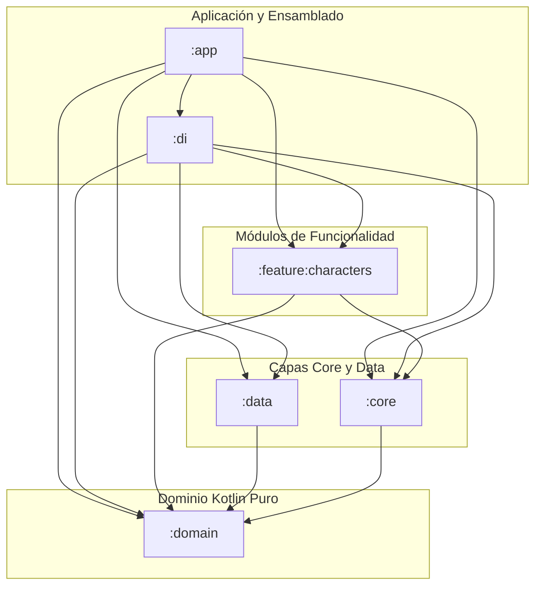

# Rick and Morty - Prueba Técnica Android

🌐 Idiomas:
- 🇬🇧 [English](README.md)
- 🇪🇸 Español (actual)

> [!NOTE]
> Se requiere **JDK 21** para compilar y ejecutar este proyecto.

Aplicación Android desarrollada como prueba técnica consumiendo la [API pública de Rick and Morty](https://rickandmortyapi.com/). Demuestra estándares de ingeniería de software para producción: **Clean Architecture**, arquitectura **multi-módulo Feature-by-Layer**, principios **SOLID**, patrón **MVI (Model-View-Intent)** con **Jetpack Compose**, cancelación reactiva de corrutinas, caché en memoria basada en consultas con TTL y reglas estáticas de arquitectura personalizadas.

---

## 🛠️ Stack Tecnológico y Librerías

- **Lenguaje:** Kotlin 2.1.0, JVM 21, Coroutines & Flow
- **UI y Presentación:** Jetpack Compose (BOM 2024.11.00), Material 3, Single Activity, Type-Safe Compose Navigation
- **Arquitectura:** Clean Architecture + Multi-Módulo Feature-by-Layer + MVI (Flujo de datos unidireccional)
- **Networking:** Retrofit 2.11.0, OkHttp 4.12.0, Kotlinx Serialization (`kotlinx.serialization.json` 1.7.3)
- **Inyección de Dependencias:** Koin 4.0.0 (inyección basada en constructores con módulos desacoplados)
- **Análisis Estático y Reglas de Arquitectura:** Detekt 1.23.7 con reglas personalizadas (`:detekt-architecture-rules`)
- **Testing:** MockK, JUnit 5, Dispatchers de prueba de Kotlinx Coroutines

---

## 🏗️ Arquitectura y Modularización

El proyecto implementa una arquitectura **Multi-Módulo Feature-by-Layer**.

### Evolución Arquitectónica y Decisiones
Originalmente concebido sobre una base que exploraba una micro-modularización extrema (más de 25 módulos separando datasources, repositorios y usecases en proyectos Gradle individuales), el proyecto fue refactorizado de forma pragmática hacia una estructura Clean Architecture multi-módulo limpia y equilibrada. Esta decisión eliminó el alto sobrecoste de sincronización y compilación de Gradle, manteniendo al 100% el aislamiento estricto entre capas, la testabilidad y el desacoplamiento de responsabilidades.

### Diagrama de Dependencias



### Desglose de Módulos

| Módulo | Responsabilidad | Dependencias |
| :--- | :--- | :--- |
| **`:domain`** | Lógica de negocio en **Kotlin 100% Puro**: modelos de dominio (`Character`), contratos de repositorios (`CharacterRepository`) y casos de uso aislados (`SearchCharactersUseCase`, `GetCharacterDetailUseCase`). Cero dependencias con Android o frameworks externos. | *Ninguna (0 dependencias)* |
| **`:data`** | Obtención y persistencia de datos: API REST con Retrofit (`RickAndMortyApi`), fuente remota (`CharacterRemoteDataSource`), mapeo de DTOs y caché en memoria con TTL (`CharacterMemoryCache`). Los DTOs nunca escapan de `:data`. | `:domain` |
| **`:core`** | Componentes reutilizables de UI (`Button`, `Text`, `TextField`), tema del sistema de diseño (`RickAndMortyTheme`), abstracción de dispatchers (`DispatcherProvider`) y utilidades de UI. | `:domain` |
| **`:feature:characters`** | Pantallas de búsqueda y detalle de personajes (`SearchScreen`, `DetailScreen`), ViewModels y contratos MVI. Los módulos de funcionalidad nunca dependen entre sí. | `:core`, `:domain` |
| **`:di`** | Agregador centralizado de módulos de Koin (`appModules`) que reúne `coreModule`, `dataModule`, `domainModule` y `charactersFeatureModule`. | `:core`, `:domain`, `:data`, `:feature:characters` |
| **`:app`** | Punto de entrada Android (`RickAndMortyApplication`), `MainActivity`, orquestación de navegación (`CharactersNavigation`) y variantes de compilación (`pre`, `pro`). | `:di`, `:core`, `:domain`, `:data`, `:feature:characters` |
| **`:detekt-architecture-rules`** | Plugin personalizado de Detekt que valida las fronteras arquitectónicas (ej. prohíbe imports de Android en `:domain` o referencias directas de UI a Data). | *Detekt API* |

---

## 🎯 Decisiones y Patrones Clave

### 1. MVI (Model-View-Intent) con Efectos Secundarios
El estado de las pantallas sigue un flujo unidireccional estructurado a través de un `BaseViewModel<State, Intent, Effect>`:
- **Estado (`UiState`):** Fuente única de verdad inmutable observada en Compose mediante `collectAsStateWithLifecycle()`.
- **Intención (`UiIntent`):** Eventos de usuario (ej. `QueryChanged`, `CharacterClicked`, `Retry`) procesados por el ViewModel.
- **Efecto (`UiEffect`):** Eventos de un solo uso (ej. `NavigateToDetail`, `ShowSnackbar`) transmitidos mediante Channels.

### 2. Cancelación Activa de Corrutinas en Búsqueda
Al teclear en la búsqueda de personajes, las corrutinas y peticiones previas aún en vuelo se cancelan inmediatamente, evitando condiciones de carrera (*race conditions*) y llamadas de red redundantes.

### 3. Caché en Memoria con TTL (Time-To-Live)
Los resultados de búsqueda y detalles se almacenan en una caché en memoria (`CharacterMemoryCache`) con un TTL de 2 minutos. Las búsquedas repetidas devuelven la información instantáneamente sin consumir red. El tiempo está desacoplado mediante la interfaz `TimeProvider` para facilitar pruebas unitarias deterministas.

### 4. Manejo Resiliente de Errores de Red
La API pública de Rick and Morty responde con un HTTP 404 y JSON `{"error": "There is nothing here"}` cuando una búsqueda no encuentra personajes. La implementación `CharacterRemoteDataSourceImpl` gestiona el HTTP 404 de forma limpia devolviendo una lista vacía en lugar de propagar excepciones inesperadas.

---

## 🚦 Controles de Calidad y Verificación

El proyecto sigue estrictos controles de calidad previos a cualquier subida de código:

```bash
# Ejecutar compilación, pruebas unitarias y análisis estático de arquitectura
./gradlew detekt assembleDebug testDebugUnitTest
```

### Git Hooks (Opcional)
Para ejecutar las validaciones automáticamente antes de cada commit:

```bash
git config core.hooksPath .githooks
chmod +x .githooks/*
```

---

## ⚙️ Monitorización de Rendimiento (Kotzilla)
El proyecto incluye el SDK de Kotzilla para analíticas de Koin y seguimiento de rendimiento:
1. Localiza `app/kotzilla.sample.json`.
2. Crea una copia llamada `app/kotzilla.json` (ignorado en Git).
3. Configura tus claves de API si deseas utilizarlo.
