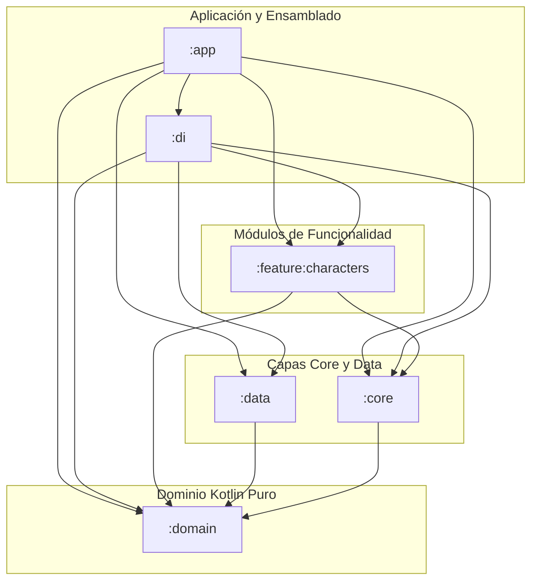

# Rick and Morty - Prueba Técnica Android

🌐 Idiomas:
- 🇬🇧 [English](README.md)
- 🇪🇸 Español (actual)

> [!NOTE]
> Se requiere **JDK 21** para compilar y ejecutar este proyecto.

Aplicación Android desarrollada como prueba técnica consumiendo la [API pública de Rick and Morty](https://rickandmortyapi.com/). Resumen de la arquitectura y técnicas principales: **Clean Architecture**, arquitectura **multi-módulo Feature-by-Layer**, principios **SOLID**, patrón **MVI (Model-View-Intent)** con **Jetpack Compose**, sistema de caché jerárquico en dos niveles (L1 RAM + L2 Room) con soporte offline, cancelación reactiva de corrutinas en búsqueda, transiciones con elemento compartido y predictive back, telemetría de rendimiento y reglas estáticas de arquitectura personalizadas.

---

## 🌐 API Pública Elegida

Se seleccionó la **[Rick and Morty API](https://rickandmortyapi.com/)** (`https://rickandmortyapi.com/api/`):

- **Endpoints consumidos:**
  - `GET /character/?name={query}&page={page}`: Búsqueda reactiva de personajes con paginación.
  - `GET /character/{id}`: Detalle completo de un personaje.
- **Motivo de la elección:**
  - **Sin autenticación requerida:** API REST pública, gratuita y de alta disponibilidad.
  - **Modelo de datos amplio:** Entidades con información diversa (especie, estado, género, origen, localización, episodios y avatares).
  - **Paginación estandarizada:** Metadatos de navegación (`pages`, `count`, `next`, `prev`).
  - **Comportamiento realista en casos límite:** Responde con HTTP 404 cuando una búsqueda no arroja resultados, lo que permite demostrar un manejo de errores robusto y limpio sin propagar excepciones a la UI.

> [!NOTE]
> **Paginación y Rate Limiting (HTTP 429):** Con la paginación, el servicio a veces devuelve un error 429 y por eso se muestra el error al obtener los personajes al final de la lista. Al pulsar en reintentar y hacer la petición de nuevo suele responder bien.

---

## 🚀 Cómo Ejecutar la Aplicación

### Requisitos Previos
- **JDK 21** configurado en el entorno.
- **Android Studio** (Ladybug / Meerkat o superior).
- Dispositivo físico o emulador Android (API 29+ recomendado).

### Build Flavors de Compilación
El proyecto define la dimensión `env` con dos variantes:
- **`pre` (Pre-producción):** TTL L1 = 2 minutos, TTL L2 = 1 hora.
- **`pro` (Producción):** TTL L1 = 5 minutos, TTL L2 = 24 horas.

### Comandos de Ejecución

```bash
# Compilar e instalar en dispositivo/emulador (variante pre o pro)
./gradlew installPreDebug
./gradlew installProDebug

# Generar APKs de depuración
./gradlew assemblePreDebug
./gradlew assembleProDebug

# Ejecutar todos los tests unitarios
./gradlew testDebugUnitTest

# Ejecutar análisis estático con Detekt y reglas personalizadas
./gradlew detekt

# Ejecutar la Quality Gate completa (compilación + tests + linter)
./gradlew assembleDebug testDebugUnitTest detekt
```

---

## 🏗️ Arquitectura y Modularización

El proyecto implementa una arquitectura **Clean Architecture Multi-Módulo Feature-by-Layer**.

### Diagrama de Dependencias



### Desglose de Módulos

| Módulo | Responsabilidad | Dependencias |
| :--- | :--- | :--- |
| **`:domain`** | **Kotlin 100% Puro**: modelos de dominio (`Character`, `PagedCharacters`), errores tipados (`AppError`), interfaces de repositorio (`CharacterRepository`) y casos de uso (`SearchCharactersUseCase`, `GetCharacterDetailUseCase`). Cero dependencias de Android o frameworks. | *Ninguna (0 dependencias)* |
| **`:data`** | Red y persistencia local: cliente Retrofit (`RickAndMortyApi`), datasource remoto, base de datos relacional Room (`RickAndMortyDatabase`), datasource local, caché en memoria (`CharacterMemoryCache`) y mapeo de entidades. Los DTOs y entidades nunca escapan de `:data`. | `:domain` |
| **`:core`** | Componentes compartidos de UI (`Button`, `Text`, `TextField`, `Loader`), tema del sistema de diseño (`RickAndMortyTheme`), abstracción de dispatchers (`DispatcherProvider`) y utilidades. | `:domain` |
| **`:feature:characters`** | Pantallas (`SearchScreen`, `DetailScreen`), ViewModels MVI y navegación interna (`CharactersNavigation`). Aislado de otros features. | `:core`, `:domain` |
| **`:di`** | Agregador centralizado de módulos de inyección de dependencias Koin (`appModules`). | `:core`, `:domain`, `:data`, `:feature:characters` |
| **`:app`** | Entrada Android (`RickAndMortyApplication`), `MainActivity`, configuración de TTL por entorno (`AppConfigModule`) y variantes de compilación. | `:di`, `:core`, `:domain`, `:data`, `:feature:characters` |
| **`:detekt-architecture-rules`** | Reglas personalizadas de Detekt que verifican las fronteras arquitectónicas (ej. prohíbe imports de Android en `:domain`). | *Detekt API* |

---

## 🎯 Decisiones Principales de Ingeniería

### 1. Arquitectura y Flujo Unidireccional MVI
Se utiliza un `BaseViewModel<State, Intent, Effect>` que asegura un flujo unidireccional estricto (UDF):
- **`UiState`:** Estado inmutable único observado en Jetpack Compose mediante `collectAsStateWithLifecycle()`.
- **`UiIntent`:** Eventos del usuario (`QueryChanged`, `CharacterClicked`, `LoadNextPage`, `Retry`).
- **`UiEffect`:** Eventos de un solo uso (`NavigateToDetail`, `ShowSnackbar`) emitidos mediante Kotlin Coroutines `Channel`.

### 2. Cancelación Activa de Corrutinas y Debounce en Búsqueda
Al teclear en el buscador de personajes, se aplica un **debounce de 300 ms** junto con la cancelación inmediata de cualquier corrutina o petición de red previa que se encuentre en vuelo mediante su `Job`. Esto elimina por completo condiciones de carrera (*race conditions*) y llamadas redundantes a la API, optimizando el consumo de datos y batería.

### 3. Sistema de Caché en Dos Niveles (L1 Memoria + L2 Room) y Modo Offline
Estrategia de Cache jerárquica:
- **L1 (Memoria RAM - `CharacterMemoryCache`):** Acceso ultra-rápido (0ms I/O) durante la sesión y transiciones de pantalla con TTL inyectado vía `CacheConfiguration` (**2 min en `pre`**, **5 min en `pro`**). Almacena tanto páginas de búsqueda como detalles de personajes individuales.
- **L2 (Disco / Room - `RickAndMortyDatabase`):** Base de datos relacional con esquema normalizado y TTL inyectado (**1 hora en `pre`**, **24 horas en `pro`**). Se compone de 3 entidades clave:
  - `CharacterEntity`: Almacena la información normalizada y completa de cada personaje (id, nombre, estado, especie, tipo, género, origen, ubicación, imagen y episodios). Evita duplicidad de registros en disco.
  - `SearchPageEntity`: Almacena los metadatos de paginación para una consulta y página concretas `(query, page)`: `totalPages`, `hasNextPage` y la marca temporal `updatedAt` para la expiración por TTL.
  - `SearchPageCharacterCrossRef`: Tabla de correspondencia relacional (*join table* N:M) entre una página de búsqueda y sus personajes. Mantiene claves foráneas con borrado en cascada (`CASCADE`) y el campo `position` para preservar el orden exacto devuelto por la API.
- **Resiliencia Offline:** Ante pérdida de conectividad o error de red, el repositorio recurre de forma transparente a los datos guardados en Room. Las búsquedas y personajes visitados previamente son totalmente navegables sin internet.
- **Desacoplamiento de Transacciones (`TransactionRunner`):** Las inserciones atómicas en Room se encapsulan tras la interfaz `TransactionRunner`, permitiendo tests unitarios puros en la JVM sin necesidad de mocks estáticos complejos de Room.
- **Testabilidad con `TimeProvider`:** La validación de expiración de TTL está desacoplada mediante `TimeProvider`.

### 4. Navegación con Elemento Compartido y Predictive Back
- Implementado con **Jetpack Navigation 3** (`androidx.navigation3`).
- Animación fluida de elemento compartido (`SharedTransitionLayout`) para el avatar del personaje entre el listado y la pantalla de detalle.
- `predictivePopTransitionSpec` personalizado con transiciones simétricas para erradicar el encogimiento anómalo durante el gesto de volver hacia atrás nativo de Android.

### 5. Telemetría y Monitorización (Kotzilla SDK 3.0.1)
Integración con Kotzilla SDK para monitorización del rendimiento, dependencias de Koin y salud de pantallas.

---

## 🛠️ Stack Tecnológico y Librerías

- **Lenguaje:** Kotlin 2.2.21, JVM 21, Coroutines & Flow
- **UI:** Jetpack Compose (BOM 2025.08.01), Material 3, Navigation 3 (1.0.0)
- **Persistencia Local:** Room 2.7.2 con KSP2
- **Networking:** Retrofit 2.11.0, OkHttp 4.12.0, Kotlinx Serialization 1.7.3
- **Inyección de Dependencias:** Koin 4.1.0
- **Monitorización:** Kotzilla SDK 3.0.1
- **Análisis Estático:** Detekt 1.23.4 con plugin propio de arquitectura
- **Testing:** JUnit 5 (Jupiter 5.10.2) para tests unitarios, MockK 1.13.10, Turbine 1.1.0, Coroutines Test 1.8.1, JUnit 4 para tests instrumentados de UI (Compose UI Testing)
