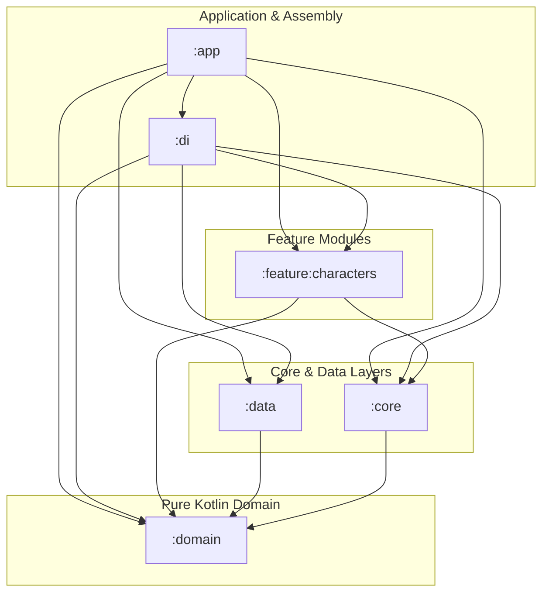

# Rick and Morty - Android Technical Assessment

🌐 Languages:
- 🇬🇧 English (default)
- 🇪🇸 [Español](README.es.md)

> [!NOTE]
> **JDK 21** is required to compile and run this project.

An Android application built as a technical assessment consuming the public [Rick and Morty API](https://rickandmortyapi.com/). Overview of the architecture and key techniques: **Clean Architecture**, **Feature-by-Layer Multi-Module structure**, **SOLID principles**, **MVI (Model-View-Intent)** with **Jetpack Compose**, two-level hierarchical cache (L1 RAM + L2 Room) with offline support, reactive coroutine cancellation on search, shared element transitions with predictive back, performance telemetry, and custom static architecture enforcement.

---

## 🌐 Public API Choice

The **[Rick and Morty API](https://rickandmortyapi.com/)** (`https://rickandmortyapi.com/api/`) was chosen:

- **Endpoints Consumed:**
  - `GET /character/?name={query}&page={page}`: Reactive character search with pagination.
  - `GET /character/{id}`: Detailed character view.
- **Rationale for Selection:**
  - **No Authentication Required:** Public, reliable, and free REST API.
  - **Rich Data Model:** Well-formed entities containing status, species, gender, origin, location, episode count, and avatar URLs.
  - **Standardized Pagination:** Clear pagination metadata (`pages`, `count`, `next`, `prev`).
  - **Realistic Edge Case Behavior:** Responds with HTTP 404 when queries yield no results, enabling demonstration of clean error handling without leaking exceptions to the UI.

> [!NOTE]
> **Pagination & Rate Limiting (HTTP 429):** During pagination, the public service occasionally returns an HTTP 429 error, which displays an error state at the end of the character list. Tapping **Retry** to reissue the request typically resolves the issue and loads the page successfully.

---

## 🚀 How to Run the Application

### Prerequisites
- **JDK 21** installed and configured.
- **Android Studio** (Ladybug / Meerkat or later).
- Physical Android device or emulator (API 29+ recommended).

### Build Flavors
The project defines the `env` dimension with two flavors:
- **`pre` (Pre-production):** L1 TTL = 2 minutes, L2 TTL = 1 hour.
- **`pro` (Production):** L1 TTL = 5 minutes, L2 TTL = 24 hours.

### Gradle Commands

```bash
# Install and run on connected device/emulator (pre or pro flavor)
./gradlew installPreDebug
./gradlew installProDebug

# Assemble debug APKs
./gradlew assemblePreDebug
./gradlew assembleProDebug

# Run all unit tests
./gradlew testDebugUnitTest

# Run static code analysis with custom Detekt rules
./gradlew detekt

# Run the complete Quality Gate (compilation + tests + linter)
./gradlew assembleDebug testDebugUnitTest detekt
```

---

## 🏗️ Architecture & Modularization

The project uses a **Clean Architecture Feature-by-Layer Multi-Module Architecture**.

### Dependency Graph



### Module Breakdown

| Module | Responsibility | Dependencies |
| :--- | :--- | :--- |
| **`:domain`** | **100% Pure Kotlin**: domain models (`Character`, `PagedCharacters`), typed errors (`AppError`), repository contracts (`CharacterRepository`), and use cases (`SearchCharactersUseCase`, `GetCharacterDetailUseCase`). Zero Android or framework dependencies. | *None (0 dependencies)* |
| **`:data`** | Networking and persistence: Retrofit REST API (`RickAndMortyApi`), remote datasource, Room relational database (`RickAndMortyDatabase`), local datasource, in-memory cache (`CharacterMemoryCache`), and entity mappers. DTOs never leak outside `:data`. | `:domain` |
| **`:core`** | Reusable UI components (`Button`, `Text`, `TextField`, `Loader`), design system theme (`RickAndMortyTheme`), dispatchers abstraction (`DispatcherProvider`), and utilities. | `:domain` |
| **`:feature:characters`** | Presentation screens (`SearchScreen`, `DetailScreen`), MVI ViewModels, and internal navigation (`CharactersNavigation`). Isolated from other features. | `:core`, `:domain` |
| **`:di`** | Centralized Koin dependency injection module aggregator (`appModules`). | `:core`, `:domain`, `:data`, `:feature:characters` |
| **`:app`** | Android entry point (`RickAndMortyApplication`), `MainActivity`, flavor TTL configuration (`AppConfigModule`), and build variants. | `:di`, `:core`, `:domain`, `:data`, `:feature:characters` |
| **`:detekt-architecture-rules`** | Custom Detekt compiler plugin enforcing strict architectural boundary rules (e.g. forbidding Android imports in `:domain`). | *Detekt API* |

---

## 🎯 Key Engineering Decisions

### 1. MVI Architecture & Unidirectional Data Flow
Screens rely on a custom `BaseViewModel<State, Intent, Effect>` enforcing strict UDF:
- **`UiState`:** Single immutable source of truth observed in Compose via `collectAsStateWithLifecycle()`.
- **`UiIntent`:** User intentions (`QueryChanged`, `CharacterClicked`, `LoadNextPage`, `Retry`).
- **`UiEffect`:** Transient single-shot events (`NavigateToDetail`, `ShowSnackbar`) delivered through a Kotlin Coroutines `Channel`.

### 2. Active Coroutine Cancellation & Debounce in Search
When typing in the search bar, a **300ms debounce** is applied alongside immediate cancellation of active in-flight search coroutines and network requests via their `Job`. This completely eliminates race conditions and avoids redundant network calls, optimizing data and battery consumption.

### 3. Two-Level Caching (L1 RAM + L2 Room Disk) & Offline Mode
Hierarchical Cache strategy:
- **L1 (In-Memory RAM - `CharacterMemoryCache`):** Instant 0ms I/O access during navigation with flavor-configured TTL (**2 min in `pre`**, **5 min in `pro`**). Caches search pages as well as individual character details.
- **L2 (Disk / Room Database - `RickAndMortyDatabase`):** Normalized relational schema with flavor-configured TTL (**1 hour in `pre`**, **24 hours in `pro`**). Structured around 3 core entities:
  - `CharacterEntity`: Stores complete, normalized character details (id, name, status, species, type, gender, origin, location, image, episode count). Prevents duplicate records across multiple searches.
  - `SearchPageEntity`: Stores pagination metadata for a specific query and page `(query, page)`: `totalPages`, `hasNextPage`, and `updatedAt` timestamp for TTL expiration.
  - `SearchPageCharacterCrossRef`: Many-to-many join table linking a search page to its characters. Enforces foreign keys with cascading deletes (`CASCADE`) and stores `position` to preserve exact API result ordering.
- **Offline Resilience:** If network connectivity fails (airplane mode or lost signal), the repository transparently falls back to Room. Any previously searched queries and character details remain fully browseable offline.
- **Transaction Decoupling (`TransactionRunner`):** Atomic multi-table Room writes are abstracted behind `TransactionRunner`, enabling pure JVM unit tests without fragile Android runtime Room mocks.
- **Testing with `TimeProvider`:** Cache TTL validation is decoupled via the `TimeProvider` interface.

### 4. Shared Element Transitions & Predictive Back
- Built with **Jetpack Navigation 3** (`androidx.navigation3`).
- Seamless `SharedTransitionLayout` animating character avatars between the search list and the detail screen.
- Custom `predictivePopTransitionSpec` with symmetric fade transitions, eliminating the visual shrink glitch during Android's native back gesture.

### 5. Telemetry & Monitoring (Kotzilla SDK 3.0.1)
Integrated with Kotzilla SDK for Koin dependency tracking and screen vitals.

---

## 🛠️ Tech Stack & Libraries

- **Language:** Kotlin 2.2.21, JVM 21, Coroutines & Flow
- **UI:** Jetpack Compose (BOM 2025.08.01), Material 3, Navigation 3 (1.0.0)
- **Local Persistence:** Room 2.7.2 with KSP2
- **Networking:** Retrofit 2.11.0, OkHttp 4.12.0, Kotlinx Serialization 1.7.3
- **Dependency Injection:** Koin 4.1.0
- **Monitoring:** Kotzilla SDK 3.0.1
- **Static Analysis:** Detekt 1.23.4 with custom architectural rule engine
- **Testing:** JUnit 5 (Jupiter 5.10.2) for unit tests, MockK 1.13.10, Turbine 1.1.0, Coroutines Test 1.8.1, JUnit 4 for Android instrumented UI tests (Compose UI Testing)
