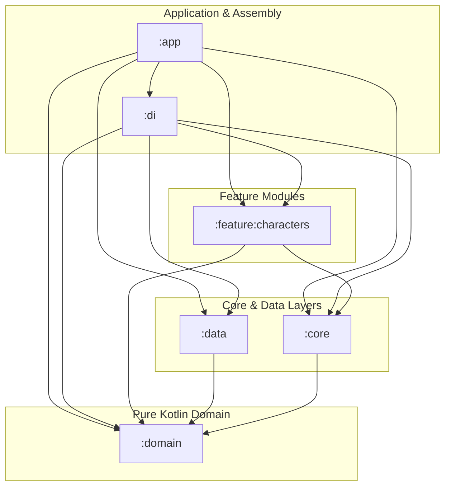

# Rick and Morty - Android Technical Assessment

🌐 Languages:
- 🇬🇧 English (default)
- 🇪🇸 [Español](README.es.md)

> [!NOTE]
> **JDK 21** is required to compile and run this project.

An Android application built as a senior-level technical assessment consuming the public [Rick and Morty API](https://rickandmortyapi.com/). It demonstrates production-grade engineering standards: **Clean Architecture**, **Feature-by-Layer Multi-Module structure**, **SOLID principles**, **MVI (Model-View-Intent)** with **Jetpack Compose**, reactive coroutine cancellation, query-based in-memory caching with TTL, and custom static architecture enforcement.

---

## 🛠️ Tech Stack & Libraries

- **Language:** Kotlin 2.1.0, JVM 21, Coroutines & Flow
- **UI & Presentation:** Jetpack Compose (BOM 2024.11.00), Material 3, Single Activity, Type-Safe Compose Navigation
- **Architecture:** Clean Architecture + Feature-by-Layer Multi-Module + MVI (Unidirectional Data Flow)
- **Networking:** Retrofit 2.11.0, OkHttp 4.12.0, Kotlinx Serialization (`kotlinx.serialization.json` 1.7.3)
- **Dependency Injection:** Koin 4.0.0 (constructor-based injection with isolated module declarations)
- **Static Analysis & Architecture Rules:** Detekt 1.23.7 with custom rules (`:detekt-architecture-rules`)
- **Testing:** MockK, JUnit 5, Kotlinx Coroutines Test Dispatchers

---

## 🏗️ Architecture & Modularization

The project uses a **Feature-by-Layer Multi-Module Architecture**. 

### Architectural Evolution & Decisions
Initially based on a starter exploring extreme micro-modularization (25+ modules separating datasources, repositories, and usecases into individual Gradle projects), the project was pragmatically refactored into a streamlined Clean Architecture multi-module structure. This eliminated massive Gradle build and sync overhead while preserving 100% strict boundary enforcement, testability, and separation of concerns.

### Dependency Graph



### Module Breakdown

| Module | Responsibility | Dependencies |
| :--- | :--- | :--- |
| **`:domain`** | **100% Pure Kotlin** business logic: domain models (`Character`), repository interfaces (`CharacterRepository`), and isolated interactors (`SearchCharactersUseCase`, `GetCharacterDetailUseCase`). Zero Android and zero third-party framework dependencies. | *None (0 dependencies)* |
| **`:data`** | Data retrieval and persistence: Retrofit REST API (`RickAndMortyApi`), remote data source (`CharacterRemoteDataSource`), DTO mapping, and in-memory TTL caching (`CharacterMemoryCache`). API DTOs never leak outside `:data`. | `:domain` |
| **`:core`** | Reusable UI components (`Button`, `Text`, `ProgressButton`), design system theme (`RickAndMortyTheme`), coroutine dispatchers abstraction (`DispatcherProvider`), and common extension helpers. | `:domain` |
| **`:feature:characters`** | Character search and detail UI screens (`SearchScreen`, `DetailScreen`), ViewModels, and MVI contracts. Feature modules never depend on each other. | `:core`, `:domain` |
| **`:di`** | Centralized Koin module aggregator (`appModules`) assembling `coreModule`, `dataModule`, `domainModule`, and `charactersFeatureModule`. | `:core`, `:domain`, `:data`, `:feature:characters` |
| **`:app`** | Android application entry point (`RickAndMortyApplication`), `MainActivity`, navigation orchestration (`CharactersNavigation`), and build flavors (`pre`, `pro`). | `:di`, `:core`, `:domain`, `:data`, `:feature:characters` |
| **`:detekt-architecture-rules`** | Custom Detekt compiler plugin enforcing layer isolation (e.g. forbidding Android imports in `:domain`, preventing UI from directly referencing Data). | *Detekt API* |

---

## 🎯 Key Architectural Decisions & Patterns

### 1. MVI (Model-View-Intent) with Side-Effects
Screen state is modeled with unidirectional data flow using a custom `BaseViewModel<State, Intent, Effect>`:
- **State (`UiState`):** Single immutable source of truth consumed in Compose via `collectAsStateWithLifecycle()`.
- **Intent (`UiIntent`):** User actions (e.g. `QueryChanged`, `CharacterClicked`, `Retry`) processed by the ViewModel.
- **Effect (`UiEffect`):** One-off transient events (e.g. `NavigateToDetail`, `ShowSnackbar`) handled through a Kotlin Channel.

### 2. Active Coroutine Cancellation
When searching characters, active coroutines and previous in-flight requests are immediately cancelled as the user types, eliminating race conditions and avoiding redundant network requests.

### 3. In-Memory Cache with TTL
Search results and character details are cached in an in-memory repository (`CharacterMemoryCache`) with a 5-minute Time-To-Live (TTL). Repeated queries hit the cache instantly without network overhead. The cache uses an injectable `TimeProvider` interface for deterministic unit testing.

### 4. Resilient Network Error Handling
The public Rick and Morty API returns HTTP 404 with body `{"error": "There is nothing here"}` when a character name search finds no results. `CharacterRemoteDataSourceImpl` handles HTTP 404 gracefully, mapping it to an empty list without throwing unexpected network exceptions.

---

## 🚦 Quality Gates & Verification

The project adheres to strict pre-flight quality checks. To verify the build locally:

```bash
# Run compilation, unit tests, and static architecture analysis
./gradlew detekt assembleDebug testDebugUnitTest
```

### Git Hooks (Optional)
To run automated quality checks before committing:

```bash
git config core.hooksPath .githooks
chmod +x .githooks/*
```

---

## ⚙️ Performance Monitoring (Kotzilla)
The project includes the Kotzilla SDK for Koin analytics and performance tracking:
1. Locate `app/kotzilla.sample.json`.
2. Create a copy named `app/kotzilla.json` (ignored by Git).
3. Supply your Kotzilla API keys if desired.
